 

<table>
<tr>
<td width="220" valign="top" align="center">

</td>
<td valign="top">

## Hello, I'm Ruturaj 👋

I'm a third-year **B.E. Electronics & Telecommunication Engineering** student at **PVG's College of Engineering, Technology and Management, Pune**, expected to graduate in 2028.

I'm interested in **digital design, RTL development, functional verification, and FPGA implementation**. My projects use Verilog, simulation, testbenches, and FPGA workflows. I'm currently learning **SystemVerilog** and building my Design Verification skills step by step.

**Career goal:** Entry-level Design Verification Engineer in the semiconductor industry.

</td>
</tr>
</table>

---

## Technical Focus

| Area | Technologies and skills |
| :-- | :-- |
| **Digital Design** | Digital electronics, combinational and sequential logic, RTL design, FSM design |
| **HDL & Verification** | Verilog, testbench development, simulation, waveform debugging, verification fundamentals; SystemVerilog *(learning)* |
| **FPGA & EDA Tools** | Xilinx Vivado, Icarus Verilog, GTKWave, EDA Playground |
| **Programming & Development** | C, Python, Git, GitHub |
| **Additional Tools** | MATLAB *(training and project-related use; see project status below)* |

---

## Featured VLSI Projects

### 1. FPGA-Based Traffic Light Controller with Priority System
Verilog-based traffic light controller with priority control logic. See the repository for RTL, testbench, simulation, and implementation details.

**Tools:** Verilog, Xilinx Vivado.

[**View repository →**](https://github.com/RuturajVyavahare/FPGA-Traffic-Light-Controller)

### 2. Low-Power ALU Design Using VLSI Techniques
A 4-bit ALU supporting eight operations, with Carry and Zero flags. The available Vivado utilization figures reported 20 LUTs (0.10%) and 18 I/O (16.98%); verify these against the report included in the repository before relying on them.

**Tools:** Verilog, Xilinx Vivado.

[**View repository →**](https://github.com/RuturajVyavahare/Low-Power-ALU-Design-Using-VLSI-Techniques)

### 3. Smart Digital Lock System
Verilog-based digital lock project using locking/unlocking control logic. Refer to the repository for the exact design and verification details.

**Tool:** Verilog.

[**View repository →**](https://github.com/RuturajVyavahare/Smart-Digital-Lock-System)

### 4. VLSI Design of FIR Filter for DSP Applications — In Progress
The project is in progress. The intended scope includes FIR filter coefficient design, Verilog implementation, simulation, and analysis of area, speed, and power. No completed implementation results are claimed here. The repository link will be added after it is confirmed.

---

## Internship Training

**Digital Electronics / VLSI Internship Training Module — Codec Technologies**

**Scheduled period:** 25 July – 25 October 2026. As of 18 October 2026, this training period is still ongoing.

The module covers digital logic design, VLSI fundamentals, Verilog/RTL design, simulation and testing, testbench development, and FPGA implementation using Vivado. Project descriptions should be understood as student training projects, not production-industry experience.

---

## Certifications & Training

The following entries were supplied for this README. Please ensure each title, issuer, result, and date matches the original certificate before publishing.

| Credential | Issuer | Result | Date |
| :-- | :-- | :-- | :-- |
| Classification | MathWorks Training Services | 100% | 1 Oct 2026 |
| Cluster Analysis | MathWorks Training Services | 100% | 1 Oct 2026 |
| Dimensionality Reduction | MathWorks Training Services | 100% | 1 Oct 2026 |
| Regression Methods with Machine Learning | MathWorks Training Services | 100% | 1 Oct 2026 |
| MATLAB Onramp | MathWorks Training Services | Completed | 23 Jan 2026 |
| Java Training | Spoken Tutorial, IIT Bombay | 90%, 4 credits | 29 Apr 2026 |
| Python 3.4.3 | Spoken Tutorial, IIT Bombay | 85%, 4 credits | 17 Oct 2026 |
| IoT Gateway Workshop | Issuer to be confirmed from certificate | Attended | 7–11 Sep 2026 |

---

## GitHub Activity

*Contribution graph provided by a third-party service; if it stops rendering, remove this image or replace it with a verified alternative.*

---

## Education & Links

**B.E. Electronics & Telecommunication Engineering**  
PVG's College of Engineering, Technology and Management, Pune · Expected graduation: 2028

 

